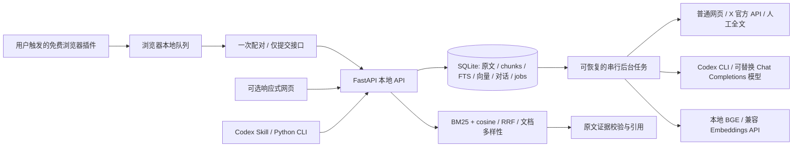

# X Second Brain · MVP 设计

产品承诺：收藏即学习，提问即调用，答案可溯源。学习指解析、分块、结构化、嵌入及检索，不训练或微调模型。

## v0.3 日常最短路径

以下是默认页面剪藏流程。0.3.2 可选 FxEmbed 适配器在预览与模型处理之间增加公开正文补取，默认关闭；启用条件、第三方数据流和未验收范围见 [FREE_FULLTEXT.md](FREE_FULLTEXT.md)。

1. 一次性加载免费Chrome/Edge插件并配对本地后台。后续无需工作台或X开发者应用。
2. 在电脑X网页先展开长文，再亲手点书签。插件仅提取已加载DOM，队列持久暂存、确认接收后移除。
3. 后台持久化原文和出处，调用本机已登录Codex做三层阅读、方法卡及自动分类，建立混合检索索引。
4. 用户直接在Codex问问题，Skill取回真实片段和引用。无依据时明确说没有找到，AI补充判断单列。
5. 预览标记待补全，不分析或进入问答；展开后点插件“保存当前内容”补全原记录。手机App及全账号历史不在插件感知范围。

首页只保留下载、配对、真实处理状态，低饱和青绿色单卡设计。插件弹窗提供连接、自动捕获开关、明确保存当前正文、待发送与待补全计数。未上架商店，无支付步骤和产品账户。详细采集边界及凭证设计见 [BACKGROUND.md](BACKGROUND.md)。

## 可选网页路径（原MVP保留）

1. 首页粘贴链接、批量链接或文章全文；保存原始来源及时间。
2. 立即持久化；后台采集、分析和索引，各自失败有明确状态且原文仍可编辑。
3. 阅读器提供 30 秒速读、3 分钟精读、深度分析与原文；每个知识结论都有逐字匹配的证据。
4. 提问从原文及方法索引做混合检索；回答分“收藏中的依据”“AI 补充建议”“分歧与待核实”，引用打开原文片段与来源链接。
5. 未配置 LLM 时支持原文管理、全文检索、本地模型就绪后的语义搜索、真实片段展示；明确不生成 AI 摘要或整合答案。

## 可选工作台交互

浅灰背景、墨色文字、低饱和蓝绿点缀。左侧紧凑知识导航；主页“收集 / 阅读 / 调用”的单工作台，上方提问入口，中部阅读队列，下方收藏。右侧抽屉阅读器以证据跳转为核心。移动端导航折叠、抽屉全屏，输入和操作按钮适合触屏；不依赖 hover、第三方字体或图像 CDN。

空库默认真实空状态，不注入虚构收藏。测试文章只能显式导入并清楚标为样例。搜索显示检索方式和语义暂不可用原因；相似文章只是相关性，不推断矛盾。跨文矛盾必须由 AI 基于至少两个来源给出证据。

## 架构

每篇文章按原始字符偏移分块；向量使用原文 + 经证据校验的方法上下文，保留原文。SQLite 存储 float32 向量并记录 provider/model 签名。个人规模用 NumPy 余弦扫描，避免额外服务；到数万篇后再替换向量索引。查询只比较相同模型的向量，模型替换需重建索引。

## 主要实体

| 实体 | 关键字段与约束 |
| --- | --- |
| article | UUID、规范 URL 唯一、正文 SHA256 唯一、title/author/published_at/saved_at、正文、状态、category/tags、分析 JSON、model、revision、错误、已读、priority |
| chunk | UUID、article_id、ordinal、start/end 字符偏移、原文、增强索引文本、vector/model；证据 quote 必须精确包含于 text |
| knowledge | 分析 JSON 内的问题、方法、原理、场景、前提、步骤、局限、质疑、证据数组 |
| job | article_id 唯一、queued/running/done/failed、错误与时间；重启恢复 running；revision 防止旧任务覆盖编辑 |
| session/message | 持久对话、结构化回答、真实来源快照；后续提问引用最近有限对话 |
| preferences | 可编辑分类与关注方向，不保存模型密钥 |
| browser_pair_code / browser_pairs | 短期一次性配对码与独立提交令牌的SHA256、扩展ID及时间，不导出凭证 |
| browser_clips / browser_events | 采集范围、原文ID与事件幂等键；预览升级和离线重试不重复处理 |

分析 schema 限制格式；引用逐字校验并定位偏移；不接受不存在的 chunk 或伪造引文。它能证明出处存在，不能形式化证明模型的每个推论；页面保留“AI 整理，未外部事实核验”。长文分批读取所有 chunks 后综合，不把截断内容称为全文分析。

优先级采用五个有理由的 1–5 分维度：信息增量、证据质量、关注相关性、实操性、长期价值。分数是阅读排序建议，不是客观事实真伪概率；无 AI 时无伪造分数。

## 运行边界

本地单用户工具，不提供多租户权限或公网生产部署。默认仅监听回环；局域网需访问令牌，远程使用需 HTTPS 反向代理。密钥只在 .env/环境变量，接口仅返回配置状态；网页不存 LLM Key。所有来源文本都视为数据，不能成为指令。采集限制协议、公共 IP、重定向、体积、超时；无浏览器 Cookie。

导出为带版本的 JSON，包含原文、元数据、分析及对话；导入按 URL/正文去重。导入分析重新验证，不信任导出的向量；重建索引以适配当前模型。v0.2 新增独立 `XSync` 后台线程，授权配置/发现ID/分页写入独立表；凭证由 `SecretStore` 加密，排除便携备份。官方授权、成本边界与运行方式见 [X_SYNC.md](X_SYNC.md)。周刊推送、iOS 快捷指令、多媒体 OCR 仍未实现。
